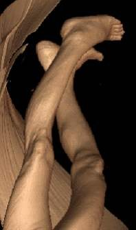

<!-- portfolio-cover-v1 -->
# VDR — Volume Deformation & Rendering

**HP-ChainMail · Active-block PBD | Hybrid deformation framework**

    

2026 · 석사 학위논문 · 연구실 코드 기반

[**Portfolio ↗**](https://soz1p.github.io/jeon-sojin-portfolio/#projects)

HP-ChainMail의 빠른 변형 전파와 PBD 제약 보정을 결합하여 CT 볼륨의 변형을 예측하고 활성 블록에 연결된 제약만 평가합니다.

학위논문 그림 3-1 · 하이브리드 프레임워크

## Highlights

| Small | Medium | Large |
| :---: | :---: | :---: |
| 10.77× | 7.96× | 2.54× |

동일 warm-start 조건에서 Global PBD 대비 Active PBD 보정 단계 속도 향상 (학위논문 표 7-5). 전체 프레임 성능이 아니라 PBD 보정 반복 1회의 평균 시간 비교입니다.

**Pipeline:** User input → HP-ChainMail → Active PBD → CUDA volume rendering

## My Contributions

하이브리드 솔버 설계, 활성 블록 기반 제약 평가와 GPU 자료구조 구현, Qt 실험 환경 모듈화.

## Master's Thesis

**CT 영상 기반 변형 시뮬레이션을 위한 혼합형 프레임워크**  
HP-ChainMail·PBD를 이용한 활성 블록 기반 제한 보정 및 STC 기반 절개 표현  
전소진 · 한성대학교 대학원 컴퓨터공학과 · 2026 · 지도교수 계희원

[Thesis PDF](papers/jeon-sojin-masters-thesis-2026.pdf) · [Official HSU Repository](https://dspace.hansung.ac.kr/handle/2024.oak/10820)

## Approach

1. HP-ChainMail로 사용자 입력에 따른 변형을 전파합니다.
2. 예측 변형 상태를 PBD의 초기 상태(warm-start)로 활용합니다.
3. 활성 블록과 연결된 제약만 선택해 보정합니다.
4. 변형된 볼륨을 GPU 렌더링으로 시각화합니다.

학위논문 그림 4-1 · 활성 블록 집합과 제한 보정 영역

## Results

| Deformation | Global PBD avg. iteration (ms) | Active PBD avg. iteration (ms) | Speedup |
| --- | ---: | ---: | ---: |
| Small | 8.46 | 0.79 | 10.77× |
| Medium | 8.53 | 1.07 | 7.96× |
| Large | 10.04 | 3.96 | 2.54× |

학위논문 표 7-5 · 동일 warm-start 조건의 PBD 보정 단계 비교. Large 조건에서는 300회 반복 상한 내 종료 조건을 만족하지 못했습니다. 속도 향상은 논문의 반올림 전 측정값에 기반한 보고 수치이며, 표의 소수 둘째 자리 시간값으로 재계산하면 차이가 날 수 있습니다.

## Source Availability

연구실 코드 및 후속 연구의 소스코드는 공개하지 않습니다. 이 페이지는 석사 연구의 개요와 연구 성과를 소개합니다.

## Performance Analysis

전체 2,560개 블록 중 활성 블록은 Small 15개(0.59%), Medium 86개(3.36%), Large 476개(18.59%)입니다. 변형이 확산될수록 평가 범위가 커지고 이득이 줄어듭니다. 제한 보정이 전역 보정과 동일한 수렴을 보장하지는 않습니다.

  

학위논문 그림 7-1 중 Lower Body / Twist · M1 / M2 / M3

## Thesis License

전소진 (2026). 공식 원문에 명시된 [CC BY-NC-ND 2.0 KR](https://creativecommons.org/licenses/by-nc-nd/2.0/kr/)에 따라 전체 PDF를 변경 없이 제공합니다. 그림의 출처는 학위논문이며 연구실 코드와 원본 CT 데이터는 포함하지 않습니다.
