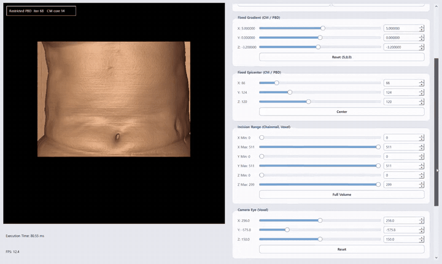
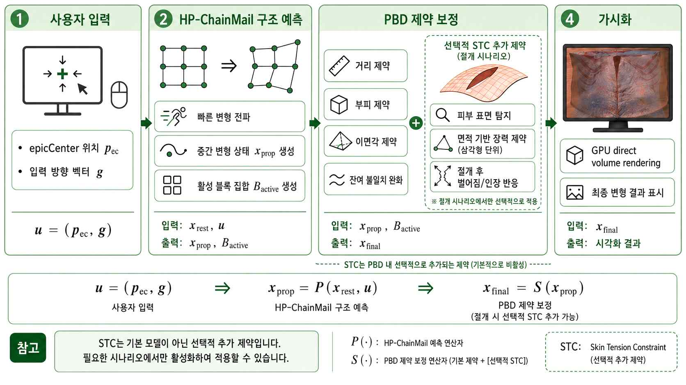
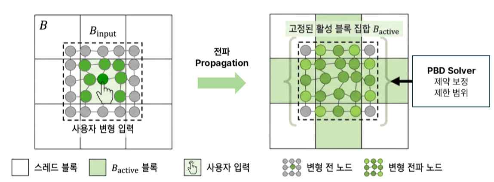
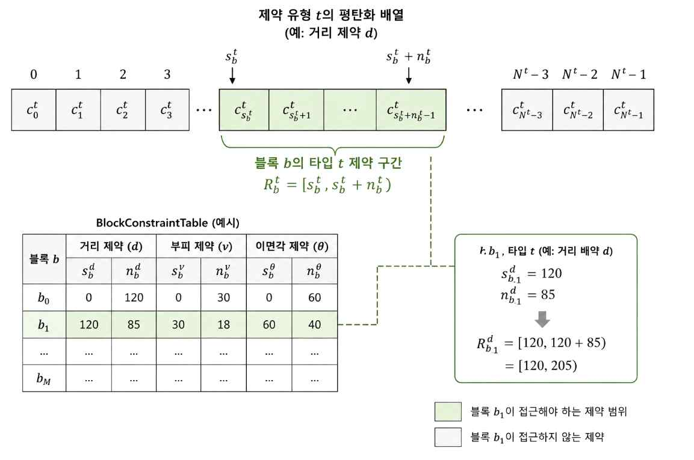
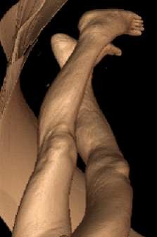
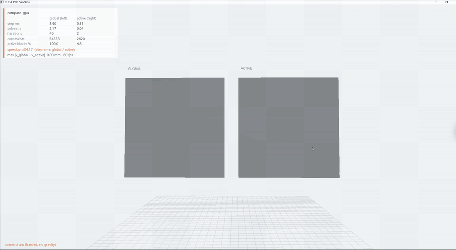

<picture>
  <source media="(prefers-color-scheme: dark)" srcset="images/header-dark.svg">
  
</picture>

<p align="center">
  <a href="https://soz1p.github.io/jeon-sojin-portfolio/#p-vdr"><b>Portfolio (KO)</b></a> &nbsp;·&nbsp; <a href="https://soz1p.github.io/jeon-sojin-portfolio/?lang=en#p-vdr"><b>Portfolio (EN)</b></a> &nbsp;·&nbsp; <a href="papers/jeon-sojin-masters-thesis-2026.pdf"><b>Thesis PDF</b></a> &nbsp;·&nbsp; <a href="https://dspace.hansung.ac.kr/handle/2024.oak/10820"><b>HSU Repository</b></a> &nbsp;·&nbsp; <a href="https://github.com/soz1p/CUDA-PBD-Sandbox"><b>Public demo code</b></a>
</p>

<p align="center">
       
</p>

> **핵심 기여** &nbsp; HP-ChainMail과 PBD를 결합한 하이브리드 솔버를 설계하고, 활성 블록만 보정해 PBD 보정 반복 속도를 최대 10.77배 높였습니다.

<p align="center"></p>
<p align="center"><sub>실행 화면 · 직접 모듈화한 Qt 실험 도구에서 조직 밀도, 변형 입력, 절개 범위, 카메라 시점을 조절하며 변형 결과를 인터랙티브하게 확인 · 전체 영상은 <a href="https://soz1p.github.io/jeon-sojin-portfolio/#p-vdr">포트폴리오</a></sub></p>

## At a glance

| Small | Medium | Large |
| :---: | :---: | :---: |
| **10.77×** | **7.96×** | **2.54×** |
| 활성 블록 0.59% | 활성 블록 3.36% | 활성 블록 18.59% |

<sub>동일 warm-start 조건에서 전체 도메인 보정(M4) 대비 활성 블록 보정(M3)의 PBD 보정 반복 1회 가속비 · 학위논문 표 7-5. 전체 프레임 속도가 아닙니다.</sub>

**Pipeline** &nbsp; User input → HP-ChainMail propagation → Active-block PBD correction → CUDA volume rendering

## STAR

| | |
| :-- | :-- |
| **S** · 상황 | 고해상도 CT 변형에서 PBD는 국소적인 변형에도 전체 영역을 반복 계산했고, ChainMail은 빠르지만 조직의 구조적 안정성을 보장하기 어려웠습니다. |
| **T** · 과제 | 두 방식의 장점을 결합하고, 변형되지 않은 영역의 불필요한 GPU 연산을 줄이는 것이 목표였습니다. |
| **A** · 내가 한 일 | • HP-ChainMail 결과를 PBD 초기 상태로 쓰는 warm-start 구조를 설계했습니다.<br>• 변형된 블록만 추적해 관련 제약만 푸는 Active Block Restricted Solve를 구현했습니다.<br>• 블록별 제약 참조 테이블과 CUDA 중복 투영 방지 로직을 구현했습니다.<br>• 위치 변화량과 부피 개선율로 반복 종료 조건을 설계했습니다.<br>• 볼륨·변형·렌더러를 모듈로 분리해 Qt 실험 도구로 구성했습니다. |
| **R** · 결과 | 보정 반복 속도가 Small 10.77배, Medium 7.96배, Large 2.54배 빨라졌습니다. 알고리즘 분석부터 GPU 자료구조 설계, 구현, 실험 도구, 성능 검증까지 연구개발 전 과정을 경험했습니다. |

## How it works

<p align="center"></p>
<p align="center"><sub>학위논문 그림 3-1 · 기존 솔버의 한계를 분석해 설계한 GPU 기반 선택적 제약 보정 구조</sub></p>

기여는 HP-ChainMail이나 PBD를 새로 정의한 데 있지 않습니다. HP-ChainMail을 PBD 앞의 **구조 예측 단계**로 두고, 그 결과인 `x_prop`과 `B_active`를 PBD의 초기 상태와 제약 평가 범위로 다시 쓰는 구조입니다.

| 식 | 의미 |
| --- | --- |
| `x_prop = P(x₀, u)` | HP-ChainMail 구조 예측 |
| `x_final = S(x_prop)` | PBD 제약 보정 |
| `d_min ≤ x_j − x_i ≤ d_max` | 이웃 요소의 상대 변위 허용 범위 |
| `C = C_d ∪ C_v ∪ C_θ` | 거리 · 부피 · 이면각 제약 |

### 1 · HP-ChainMail 전파와 PBD warm-start
이웃 요소의 상대 변위가 물성별 허용 범위를 벗어나면 그 범위 안으로 끌어오면서 변형을 퍼뜨립니다. 이렇게 만든 `x_prop`에서 PBD를 시작하는 것을 **warm-start**, 변형 전 상태에서 시작하는 기존 방식을 **cold-start**로 구분했습니다. ChainMail이 edge 구조는 먼저 잡아주지만 사면체 부피는 보장하지 않으므로, 반복 종료에는 정점 위치 변화량의 최댓값과 **부피 제약 위반량의 개선율**을 씁니다.

### 2 · Active Block Restricted Solve
<p align="center"></p>

볼륨을 8³ 블록으로 나누고, ChainMail 전파가 실제로 지나간 블록을 `B_active`로 기록합니다. 원래 전파 관리용이던 이 정보를 PBD가 **어디를 보정할지 정하는 범위**로 재사용했습니다. 전파가 끝나면 `B_active`는 고정되고, PBD는 전체 도메인 대신 이 블록에 연결된 제약만 평가합니다.

### 3 · BlockConstraintTable
<p align="center"></p>

- **모든 관련 블록에 등록** · 거리 제약은 edge의 두 정점, 부피 제약은 사면체의 네 정점이 속한 블록 모두에 등록해 경계에 걸친 제약이 빠지지 않게 했습니다.
- **평탄화 배열과 구간 인덱스** · 초기화 때 CPU에서 한 번 만들어 제약 유형별 연속 배열과 블록별 시작 위치·개수로 GPU에 올리고, 반복 중에는 활성 블록의 구간만 순회합니다.
- **중복 투영 방지** · 제약별 정수 플래그를 매 반복 0으로 초기화하고, `atomicCAS`로 0을 1로 처음 바꾼 스레드만 투영합니다.

## Qt experiment tool

연구 알고리즘을 동일한 CT 볼륨과 입력에서 여러 솔버로 비교할 수 있는 실험 소프트웨어로 모듈화했습니다.

```
QMainWindow · Volume Deformation Research
├── GLWidget : QOpenGLWidget      CUDA 렌더 프레임 · 표면 선택 · 드래그 입력
├── InfoPanel                     프레임 시간 · FPS
└── QScrollArea › ControlPanel    밀도 구간 · 데이터셋 · 고정 입력 · 입력 방향 g · epiCenter
                                  절단 범위 · 카메라 · ChainMail 실험 프리셋 · 기준 벤치마크
```

- **인터페이스와 팩토리** · `Volume`, `Deformer`, `Renderer` 인터페이스와 각 Factory가 CTVolume, ChainMail·PBD, CUDA VolumeRenderer를 만들어, 변형기나 렌더러를 바꿔도 화면 코드는 그대로입니다.
- **명확한 소유권** · 모듈을 `std::unique_ptr`로 만들어 VDR → MainWindow → GLWidget으로 이동시켜 GPU 자원의 수명을 한곳에서 관리합니다.
- **시그널과 슬롯** · ControlPanel의 시그널 12개를 GLWidget 슬롯에 연결하고, GLWidget은 프레임 시간을 InfoPanel로, 볼륨 크기를 ControlPanel 슬라이더 범위로 돌려보냅니다. 패널끼리는 서로를 모릅니다.
- **비교 프리셋** · Prop Only, Restricted Active, Global Solve, Pure ChainMail, Pure PBD, Cold Restricted로 논문의 비교 방법(M1~M4)을 같은 입력에서 바로 실행합니다.
- **입력 재현과 자동 캡처** · 고정 입력 모드로 같은 변형을 반복하고, `QTimer`로 프리셋을 차례로 실행해 같은 카메라로 화면을 저장합니다.
- **빌드와 점검** · CMake에서 vdr 정적 라이브러리와 실행 파일을 분리하고, `--display-self-test`로 CUDA 없이 화면 표시만 검사합니다.

```cpp
connect(_controlPanel, &ControlPanel::runChainmailExperiment,
        _glWidget,     &GLWidget::runChainmailExperiment);
connect(_glWidget,     &GLWidget::updateFrameTime,
        _infoPanel,    &InfoPanel::showFrameTime);
connect(_glWidget,     &GLWidget::volumeBoundsChanged,
        _controlPanel, &ControlPanel::setVolumeBounds);
```

## Results

| 변형 규모 | 활성 블록 | M4 Global (ms) | M3 Active (ms) | 속도 향상 |
| --- | ---: | ---: | ---: | ---: |
| Small | 15 / 2,560 | 8.46 | 0.79 | **10.77×** |
| Medium | 86 / 2,560 | 8.53 | 1.07 | **7.96×** |
| Large | 476 / 2,560 | 10.04 | 3.96 | **2.54×** |

<sub>학위논문 표 7-5 · Abdomen · 보정 반복 1회 평균 · 가속비는 논문의 반올림 전 측정값 기반 보고값입니다.</sub>

| 규모 | M1 ChainMail only | M2 PBD cold-start | M3 Hybrid (제안) |
| --- | --- | --- | --- |
| Small | 0.98 ms | 8.11 ms · 300회 ✗ | **0.79 ms · 59회 ✓** |
| Medium | 0.92 ms | 8.17 ms · 300회 ✗ | **1.07 ms · 68회 ✓** |
| Large | 0.92 ms | 8.25 ms · 300회 ✗ | 3.96 ms · 300회 ✗ |

<sub>학위논문 표 7-4 · relaxMs와 반복 횟수, 반복 상한 300회 내 종료 여부</sub>

<p align="center">  </p>
<p align="center"><sub>학위논문 그림 7-1 중 Lower Body / Twist · M1 / M2 / M3. M1은 비틀림이 몰린 부위가 가늘어지고, M3는 PBD 보정으로 M2와 비슷한 구조적 변형을 보입니다.</sub></p>

<sub>실험 환경 · NVIDIA GeForce RTX 3090, AMD Ryzen 9 3900X, Windows 10, C++ / CUDA 12.6 · Abdomen 512×512×300, Head 512×512×544, Lower body 512×512×1152 CT를 4배 다운샘플링 · 블록 크기 8³</sub>

## Public demo · CUDA-PBD-Sandbox

연구실 코드와 CT 데이터는 공개할 수 없어, 활성 블록 제한 보정의 아이디어를 합성 격자 천 위에서 처음부터 다시 구현한 데모를 따로 공개했습니다. 기본 구조만 보여 주도록 모든 제약을 거리 제약으로 계산합니다(굽힘은 한 칸 건너뛴 정점 사이의 거리로 근사).

<p align="center"></p>
<p align="center"><sub>비교 모드 · 왼쪽은 전체 보정, 오른쪽은 활성 블록 보정. 같은 정점에 같은 입력이 들어가고, 주황 칸은 이번 프레임에 보정한 블록입니다.</sub></p>

- **같은 구조:** 8×8 정점 블록, 블록별 CSR 제약 표, 깨어 있는 블록 + 8-이웃만 보정, 잠든 블록 경계는 고정점으로 처리.
- **잠드는 규칙:** 속도와 제약 오차가 30프레임 연속으로 안정된 블록만 잠듭니다. 속도만 보고 재웠을 때 21 mm 가까이 나던 전체 보정과의 차이가 2.1 mm로 줄었습니다.
- **전환 기준:** 활성 비율이 70%를 넘으면 전체 보정 경로로 계산합니다. 위 Large 조건처럼 변형이 넓을 때 이득이 줄어드는 문제를, 손해를 보지 않는 방향으로 다룹니다.
- **결과:** RTX 3090, 96×96 천을 반복해서 누르는 장면에서 step 1.223 → 0.565 ms로 **2.16배** 빨랐습니다 (평균 활성 블록 28.7%).
- **실시간 뷰어:** Win32 + OpenGL 3.3, 외부 라이브러리 없음. `C` 키로 두 솔버를 나란히 비교합니다.

👉 **[soz1p/CUDA-PBD-Sandbox](https://github.com/soz1p/CUDA-PBD-Sandbox)** — 빌드 방법, 벤치마크, 옵션은 데모 저장소의 README에 있습니다.

## Limitations & next steps

- 변형이 넓게 퍼지면 활성 블록이 늘어 전체 보정에 가까운 비용이 듭니다. Large 조건에서는 2.54배로 줄고 반복 상한 안에 종료하지 못했습니다.
- 측정 시간은 방법 간 비교를 위한 보수적인 종료 조건의 결과입니다. 고정된 소수 반복으로 운용하는 조건은 따로 재야 합니다.
- 변형 결과 평가가 정성 비교 중심이라, 형상 오차 같은 정량 지표가 필요합니다.
- 큰 변형에서 이득이 줄어드는 문제는 [공개 데모](https://github.com/soz1p/CUDA-PBD-Sandbox)에서 활성 비율 70% 초과 시 전체 보정으로 넘어가는 전환 기준으로 다뤘습니다.

## Master's thesis

**CT 영상 기반 변형 시뮬레이션을 위한 혼합형 프레임워크**
HP-ChainMail·PBD를 이용한 활성 블록 기반 제한 보정 및 STC 기반 절개 표현
전소진 · 한성대학교 대학원 컴퓨터공학과 · 2026 · 지도교수 계희원

[Thesis PDF](papers/jeon-sojin-masters-thesis-2026.pdf) · [Official HSU Repository](https://dspace.hansung.ac.kr/handle/2024.oak/10820)

## Source availability & license

연구실 코드, 후속 연구 코드, 원본 CT 데이터는 공개하지 않습니다. 활성 블록 기법은 연구 코드를 옮기지 않고 새로 작성한 [CUDA-PBD-Sandbox](https://github.com/soz1p/CUDA-PBD-Sandbox)(MIT)로 확인할 수 있습니다. 학위논문은 공식 원문에 명시된 [CC BY-NC-ND 2.0 KR](https://creativecommons.org/licenses/by-nc-nd/2.0/kr/)에 따라 변경 없이 제공하며, 그림의 출처는 학위논문입니다.

---

<sub>전소진 · Jeon Sojin · Graphics Engineer &nbsp;|&nbsp; <a href="https://soz1p.github.io/jeon-sojin-portfolio/">Portfolio</a> · <a href="https://github.com/soz1p">GitHub</a> · <a href="https://www.linkedin.com/in/soz1p">LinkedIn</a> · jeonsoz1p@gmail.com</sub>
